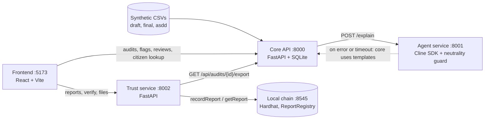

# VoterGuard India

VoterGuard India is an open-source, non-partisan toolkit that helps people check how an electoral roll
changed between a draft and a final revision. It compares the two rolls and the list of recorded removal
reasons, flags booth-level patterns that look unusual compared with the rest of the constituency, and
hands those flags to human reviewers for verification. Citizens can look up their own entry, and every
published report is fingerprinted (SHA-256) and recorded on a local blockchain so anyone can later check
that a report file has not been altered. **This repository uses synthetic data only.**

## The problem

Every roll revision adds, removes and edits tens of thousands of entries. Today it is hard for an
ordinary citizen, a journalist or a party worker to answer two simple questions:

1. **Did this revision change in a way that is worth a closer look?** Booth-level numbers are rarely
   published in a form that can be compared across a constituency.
2. **Is the report I am reading the same one that was published?** Documents can be re-edited, re-sent and
   quoted out of context, and there is no cheap way to tell.

VoterGuard India addresses the *verifiability* of revisions: it makes patterns visible, keeps a human in
the loop, and makes published reports tamper-evident.

## What it does, and what it does not do

| It does | It does NOT |
| --- | --- |
| Compare draft roll, final roll and removal list; count additions, removals and edits per booth | Decide whether any person is eligible to vote |
| Flag booth-level patterns that are unusual and worth verifying (seven detectors, see [docs/METHODOLOGY.md](docs/METHODOLOGY.md)) | Declare wrongdoing by anyone. A flag is a prompt for a field check, nothing more |
| Let a citizen see whether an entry appears in the draft and/or final roll, with masked identifiers | Show or store other people's records. Lookups return a masked EPIC and "first name + last initial" |
| Record the SHA-256 of a report on a local chain so a later copy can be checked | Prove that a report is *correct*. A matching hash proves the file is unchanged, not that its findings are right |
| Analyse only gender and age bands | Infer religion, caste or citizenship, from names or anything else |

All numbers, flags and scores come from deterministic code. An LLM may only phrase the explanation text,
and its output is checked by a deterministic guard before it is shown.

## Architecture



| Part | Folder | Port | Role |
| --- | --- | --- | --- |
| Core API | [`backend/`](backend/README.md) | 8000 | Pipeline (compare, aggregate, detect, score), audits, flags, reviews, citizen lookup |
| Agent service | [`agent-service/`](agent-service/README.md) | 8001 | Phrases each flag in English and Hindi with the Cline SDK; neutrality guard |
| Trust service | [`trust-service/`](trust-service/README.md) | 8002 | Builds the report, hashes it, records it on the chain, serves files, verifies uploads |
| Chain | [`chain/`](chain/README.md) | 8545 | Hardhat node and the `ReportRegistry` contract |
| Frontend | [`frontend/`](frontend/README.md) | 5173 | Citizen page, reviewer dashboard, verify page (English and Hindi) |

The API contract between them is [contracts/CONTRACT.md](contracts/CONTRACT.md). The detectors, thresholds
and risk score are described in [docs/METHODOLOGY.md](docs/METHODOLOGY.md); a five-minute walkthrough is in
[docs/DEMO_SCRIPT.md](docs/DEMO_SCRIPT.md).

## Quick start

Requirements: Python 3.11+, Node 22+, npm 10+. The services read plain environment variables (they do not
load `.env` themselves), so each terminal below first loads the root `.env`:
`cp .env.example .env` once, then `set -a; source .env; set +a` in every terminal.

One-time install:

```bash
pip install -r backend/requirements.txt -r trust-service/requirements.txt
(cd agent-service && npm install) && (cd chain && npm install) && (cd frontend && npm install)
cp frontend/.env.example frontend/.env.local   # then set VITE_USE_MOCKS=false to use the real services
```

Six commands, one terminal each, in this order:

```bash
# 1. Local chain (chain id 31337). Prints the dev accounts: copy the private key of account #1.
cd chain && npm run node

# 2. Deploy the contract and allow account #1 as a submitter (the node resets on restart: redeploy each time)
cd chain && npm run deploy:local

# 3. Trust service. Put account #1's key in SUBMITTER_PRIVATE_KEY (in .env, before sourcing it)
cd trust-service && python -m uvicorn app.main:app --port 8002

# 4. Core API. AUTO_SEED=true builds the synthetic audit aud_001 on first start
cd backend && AUTO_SEED=true python -m uvicorn app.main:app --port 8000

# 5. Agent service. Works offline with no key: it falls back to deterministic mock text
cd agent-service && MOCK_AGENT=true npm run dev

# 6. Frontend at http://localhost:5173
cd frontend && npm run dev
```

Then check everything end to end without a browser:

```bash
make smoke                       # runs scripts/e2e_smoke.py and prints a PASS/FAIL list
make smoke SMOKE_ARGS=--seed     # also creates the synthetic audit if the core has none
```

The Makefile also has `make backend` and `make agent` for steps 4 and 5. Health endpoints:
`GET :8000/api/health`, `GET :8001/health`, `GET :8002/api/health`, `GET :8002/api/chain/status`.

The `SUBMITTER_PRIVATE_KEY` is a public Hardhat development key for the local node only. Never use it
anywhere else and never commit keys.

## Environment variables

Defaults are in [.env.example](.env.example). The frontend variables go in `frontend/.env.local`.

| Variable | Used by | Default | Meaning |
| --- | --- | --- | --- |
| `CORE_URL`, `AGENT_URL`, `TRUST_URL` | trust, core, smoke script | `:8000`, `:8001`, `:8002` | Where each service finds the others |
| `CHAIN_RPC_URL` | trust | `http://127.0.0.1:8545` | Hardhat JSON-RPC |
| `AUTO_SEED` | core | `false` | `true` creates `aud_001` from synthetic data when no audit exists |
| `CLAIMS_DEADLINE` | core | empty | Date shown in the citizen "what you can do" box (for example `2026-10-31`) |
| `AGENT_TIMEOUT_SECONDS` | core | `8` | How long the core waits for the agent before using templates |
| `DATA_DIR` | core | `backend/data` | SQLite database, synthetic CSVs and audit snapshots |
| `PORT` | agent | `8001` | Agent HTTP port |
| `ANTHROPIC_API_KEY` | agent | empty | Empty means mock mode (no LLM is called) |
| `AGENT_PROVIDER_ID`, `AGENT_MODEL_ID` | agent | `anthropic`, `claude-sonnet-5-5` | Cline SDK provider and model |
| `MOCK_AGENT` | agent | `false` | `true` forces mock mode even when a key is set |
| `SUBMITTER_PRIVATE_KEY` | trust | empty | Signs `recordReport` transactions (Hardhat account #1) |
| `REPORT_DIR` | trust | `./data/reports` | Saved `VG-*.json` and `VG-*.pdf` files |
| `VITE_CORE_URL`, `VITE_TRUST_URL` | frontend | `:8000`, `:8002` | Service URLs used by the browser |
| `VITE_USE_MOCKS` | frontend | `true` in `frontend/.env.example` | `false` talks to the real services (needed for the demo) |

More per-service variables are listed in the service READMEs.

## How the Cline SDK is used

The agent service ([`agent-service/`](agent-service/README.md)) uses the [Cline SDK](https://docs.cline.bot/sdk)
(`@cline/sdk`) for one job: turning a numeric flag into a short, neutral, bilingual explanation.

- **Explainer agent.** An SDK `Agent` receives the booth, the flag and the constituency baseline. It can call
  three custom tools made with `createTool` (`get_booth_stats`, `get_baseline`, `get_flag_metric`) that read
  from the request itself, with no network access, and it answers with JSON: `explanation` and
  `recommended_checks`, each in English and Hindi.
- **Neutrality guard.** A deterministic check runs on every string before it is returned: a blocklist of loaded
  words in English and Hindi, and a number check that every figure in the text appears in the request.
  Failures go to a second SDK `Agent` (the reviewer) that rewrites only the listed problems. After two
  rewrites the service answers `422 NEUTRALITY_FAILED`.
- **The model never produces a number, flag or score.** Those come from the core API's deterministic code.

**Offline fallback.** The system works with no API key and no internet:

1. With no `ANTHROPIC_API_KEY` (or `MOCK_AGENT=true`) the agent service runs in mock mode and builds
   deterministic neutral text from the payload.
2. If the agent service is down, slow (over `AGENT_TIMEOUT_SECONDS`), or answers `422` or `503`, the core API
   uses its own bilingual templates and marks the flag `explanation_source: "template"`.

## Privacy and safety design

The design follows the mindset of India's Digital Personal Data Protection Act, 2023: collect the minimum,
use it only for the stated purpose, and keep nothing that is not needed. This is a design intent for a
demo, not a legal compliance claim.

- **Synthetic data only.** All rolls are generated (`backend/app/synth`, seed 42). EPIC numbers start with
  `VGX` so nobody mistakes them for real IDs. Real voter data must never be scraped or committed.
- **Masked identifiers.** The citizen lookup returns the EPIC as `VGX****051`, the name as "Sunita D.", and an
  age band. When several entries match equally well it returns nothing about any of them (`AMBIGUOUS`).
- **Nothing typed is kept.** Names and EPIC numbers entered in the lookup are not logged or stored, and the
  endpoint is rate limited (20 requests per minute per client IP).
- **Aggregate by default.** The reviewer views and reports contain booth-level counts and shares, not
  individual records.
- **Only gender and age bands are analysed.** Religion, caste and citizenship are never inferred, from names
  or from anything else.
- **Careful language.** Code comments, UI text, generated text and test data say "unusual", "worth
  verifying" and "recommend a field check". The guard blocks accusatory wording.

## Limitations

- Synthetic data only. Behaviour on real rolls is untested, and real rolls differ in ways the generator does not model.
- Detectors compare booths with their own constituency. They assume most booths are ordinary and will miss a
  pattern that is spread evenly everywhere. Thresholds are starting points, not calibrated values.
- Many ordinary events create the same patterns (a factory closure, a flood, seasonal migration). See the
  false-positive list in [docs/METHODOLOGY.md](docs/METHODOLOGY.md). A flag never says why.
- A matching hash proves a file is unchanged since it was recorded. It says nothing about whether the findings are right.
- The chain is a local Hardhat node: it resets when restarted, and the submitter allow-list is a single dev key.
- The reviewer pages have no login in this demo.
- Citizen name matching is approximate (spelling variants), so a different person can match, or a correct entry can be missed.
- The PDF includes Hindi text only if a Devanagari font is placed in `trust-service/assets/`.
- In agent mock mode the explanation is still labelled `explanation_source: "agent"` because the contract has
  only two values; the UI then shows it as "AI-assisted" although no model was called.

## Contributing

Contributions are welcome. Please keep the neutrality rules above in every change.

- Follow [contracts/CONTRACT.md](contracts/CONTRACT.md) exactly; do not rename fields. Change it only by agreement of both owners.
- Ownership (see `.github/CODEOWNERS`): Member A owns `backend/`, `agent-service/`, `contracts/`, `scripts/`;
  Member B owns `frontend/`, `trust-service/`, `chain/`, `docs/`, `README.md`. Open an issue or message the owner before editing another area.
- Python 3.11 with type hints; Node 22 with TypeScript strict. Keep functions small and documented; every module gets tests.
- Never commit secrets, `node_modules`, `data/`, `.venv` or build artifacts.
- Run the tests for what you changed:

```bash
cd backend && python -m pytest -q        # core API and detectors
cd trust-service && python -m pytest -q  # trust service
cd agent-service && npm test             # agent service
cd chain && npm test                     # contract
cd frontend && npm test && npm run typecheck
python -m pytest scripts                 # smoke script helpers
```

## Licence

[MIT](LICENSE).
